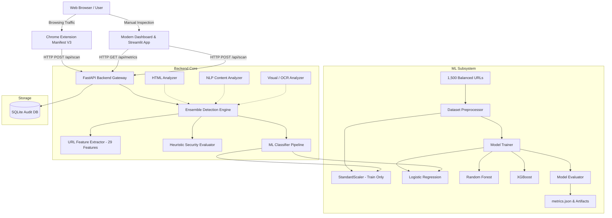

# Phishing Detection System Architecture

## System Components

## Security Design & Data Integrity
1. **Data Leakage Prevention**: `StandardScaler` is strictly fit on the training partition ($N=1,200$) and never exposed to the test partition ($N=300$).
2. **Deduplication**: Strict hash and string deduplication runs before feature vector extraction.
3. **Multi-Layer Defense**: Heuristics catch immediate known attack signatures (such as raw IP hosts and embedded TLD subdomains) while ML identifies subtle multi-dimensional statistical patterns.
4. **Observable Metrics**: All evaluation scores (accuracy, precision, recall, F1, ROC-AUC, confusion matrices) are calculated dynamically on the test set and saved directly to `ml/saved_models/metrics.json`.
